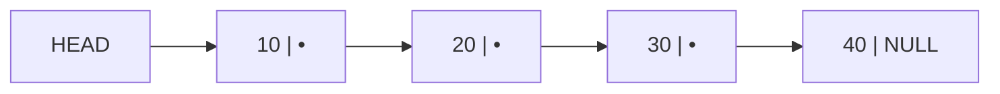
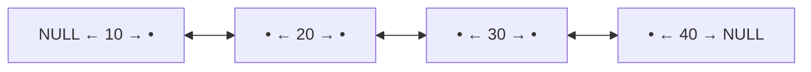
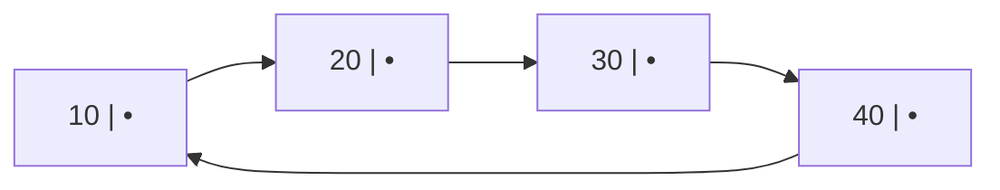

# Sample Answers — ExamIntel Research Engine

These examples demonstrate the expected writing quality and structure for different mark levels. Notice how the language is natural, the explanations are clear, and there are no AI cliches.

---

## Example 1: 2-Mark Answer

**Question:** Define a Stack and list its operations. (2 Marks)

**Answer:**

A stack is a linear data structure where insertion and removal of elements happen only at one end, called the **top**. It follows the **LIFO (Last-In-First-Out)** principle — the element added last is removed first, like a pile of plates.

**Main operations:** `push(x)` — insert element at top, `pop()` — remove top element, `peek()` — view top without removing, `isEmpty()` — check if stack is empty. All operations take O(1) time.

---

## Example 2: 5-Mark Answer

**Question:** Explain the Binary Search algorithm with a suitable example. (5 Marks)

**Answer:**

Binary Search is a fast searching method that works on **sorted arrays**. Instead of checking every element one by one (which is what linear search does), it cuts the search area in half at each step.

**How it works:**

The algorithm picks the middle element of the current range and compares it with the target value. Three things can happen:
- If the middle element matches the target, the search is done.
- If the target is smaller, we discard the entire right half and search only in the left half.
- If the target is larger, we discard the left half and search in the right half.

This process keeps repeating until the element is found or no elements remain.

**Example — Search for 23 in [5, 10, 15, 20, 23, 30, 35]:**

| Step | Low | High | Mid | arr[Mid] | Action |
|------|-----|------|-----|----------|--------|
| 1 | 0 | 6 | 3 | 20 | 23 > 20 → search right half |
| 2 | 4 | 6 | 5 | 30 | 23 < 30 → search left half |
| 3 | 4 | 4 | 4 | 23 | Found at index 4 |

The search found 23 in just 3 comparisons instead of 5 (which linear search would need).

**Time Complexity:**
- Best case: O(1) — target is at the middle
- Average and worst case: O(log n) — search space halves each time
- Prerequisite: The array **must** be sorted first

Binary search is used in phone directories, database indexing, and searching in any sorted collection where speed matters.

---

## Example 3: 12.5-Mark Answer

**Question:** What are the different types of linked lists? Explain singly, doubly, and circular linked lists with diagrams and operations. (12.5 Marks)

**Answer:**

### Introduction

A linked list stores data in separate blocks called **nodes**, where each node contains the actual data and a pointer (address) to the next node. Unlike arrays, linked lists do not need contiguous memory — each node can sit anywhere in memory and just points to the next one. This makes insertion and deletion much faster because no shifting is needed.

There are three main types of linked lists: singly linked list, doubly linked list, and circular linked list. Each has a different node structure and serves different use cases.

### 1. Singly Linked List

In a singly linked list, each node has two parts: the data and a pointer to the next node. The last node points to `NULL`, marking the end of the list. You can only move in one direction — from the head (first node) toward the tail (last node).



**Node structure in C:**
```c
struct Node {
    int data;
    struct Node *next;
};
```

**Insertion at the beginning:**
1. Create a new node and store the data.
2. Set the new node's `next` pointer to the current head.
3. Update the head to point to the new node.

This takes O(1) time because we only change two pointers.

**Deletion from the beginning:**
1. Store the head node in a temporary variable.
2. Move the head to the second node (`head = head->next`).
3. Free the memory of the old head.

**Limitation:** You cannot go backward. If you need to reach the previous node, you must start from the head again.

### 2. Doubly Linked List

A doubly linked list adds a second pointer to each node — a `prev` pointer that points to the previous node. This means you can move both forward and backward through the list.



**Node structure in C:**
```c
struct Node {
    int data;
    struct Node *prev;
    struct Node *next;
};
```

**Insertion after a given node:**
1. Create a new node.
2. Set the new node's `next` to the given node's `next`.
3. Set the new node's `prev` to the given node.
4. Update the given node's `next` to the new node.
5. Update the following node's `prev` to the new node.

**Deletion of a specific node:**
Doubly linked lists make deletion easier because you already have the `prev` pointer. You just link the previous node directly to the next node and free the deleted node's memory.

**Advantage over singly linked list:** Bidirectional traversal and easier deletion.
**Disadvantage:** Each node uses extra memory for the `prev` pointer.

### 3. Circular Linked List

In a circular linked list, the last node does not point to `NULL`. Instead, it points back to the first node, forming a circle. This can be applied to both singly and doubly linked lists.



**Key difference:** There is no `NULL` terminator. You know you have completed one full cycle when you return to the starting node.

**Insertion in a circular linked list:**
1. Create a new node.
2. If the list is empty, point the new node to itself.
3. Otherwise, insert after the last node and update the last node's pointer to the new node.

**Traversal:**
Start at any node and keep following `next` pointers until you reach the starting node again.

**Applications:**
- Round-robin CPU scheduling (each process gets a turn, then it cycles back)
- Music playlist on repeat mode
- Circular buffer for streaming data

### Comparison Table

| Feature | Singly | Doubly | Circular |
|---------|--------|--------|----------|
| Node pointers | 1 (next) | 2 (next + prev) | 1 or 2 |
| Traversal | Forward only | Both directions | Continuous loop |
| Memory per node | Less | More | Same as base type |
| Deletion efficiency | Need previous node reference | Direct (has prev) | Depends on type |
| Last node points to | NULL | NULL | First node |
| Use case | Simple lists | Browser history, text editors | Scheduling, playlists |

### Conclusion

Singly linked lists are the simplest and use the least memory per node. Doubly linked lists trade extra memory for the convenience of backward traversal and easier deletion. Circular linked lists are best when you need to cycle through elements continuously without stopping at the end. The choice depends on what operations your program needs most.

---

## Writing Quality Notes

Notice these characteristics of the answers above:

1. **No AI cliches** — no "in today's modern world", no "it is important to note"
2. **Teacher-like tone** — explains concepts step by step as if speaking to a student
3. **Real structure** — definitions first, then how it works, then examples
4. **Practical examples** — music playlists, phone directories, browser history
5. **Appropriate depth** — 2-mark answer is tight; 12.5-mark answer covers everything
6. **Diagrams where useful** — Mermaid diagrams for all three linked list types
7. **Code when needed** — C struct definitions help students implement the concept
8. **Comparison table** — helps students differentiate and remember
