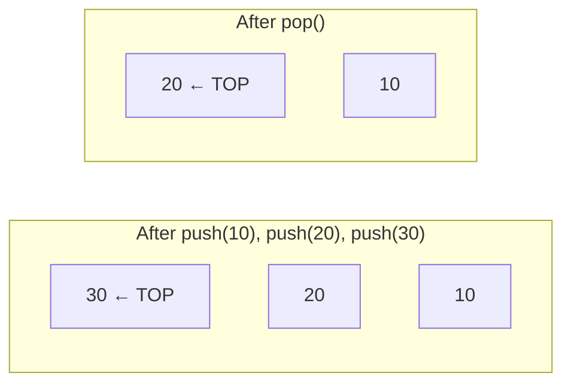
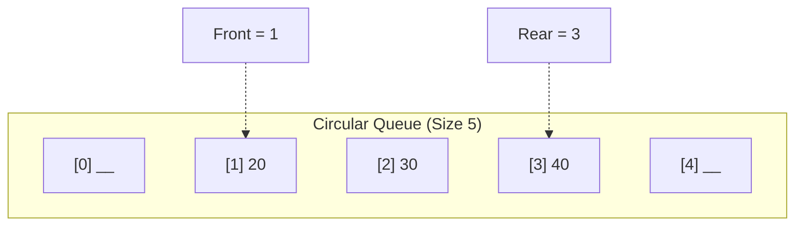

# Sample Study Notes — Unit 3: Stacks and Queues

> **Syllabus Reference:** BCA 3rd Semester — Data Structures Using C and C++ — Unit 3
> **Exam Weightage:** ~15-20 marks | **PYQ Frequency:** High (asked every year)

---

## Unit Overview

Stacks and queues are two of the most commonly used data structures in programming. Both store collections of elements, but they differ in how elements are added and removed. Understanding these two structures is essential because they appear in everything from function calls in your programs to managing print jobs on a printer.

---

## Topic 1: Stacks

### What Is a Stack?

A stack is a linear data structure where you can only add or remove elements from one end, called the **top**. It works on the **LIFO (Last-In-First-Out)** principle — the most recently added element is the first one to come out.

### Real-World Analogy

Think of a stack of plates in a cafeteria. When the kitchen washes plates, they stack them on top of each other. When a customer needs a plate, they pick the one on top — not the one at the bottom. The last plate placed on the stack is the first plate picked up.

### Stack Operations

| Operation | What It Does | Time |
|-----------|-------------|------|
| `push(x)` | Adds element `x` on top of the stack | O(1) |
| `pop()` | Removes and returns the top element | O(1) |
| `peek()` / `top()` | Returns the top element without removing it | O(1) |
| `isEmpty()` | Returns true if the stack has no elements | O(1) |
| `isFull()` | Returns true if the stack is full (array implementation) | O(1) |

All operations are O(1) because we only ever touch the top element.

### How Push and Pop Work



**Push:** Increase the top pointer by 1, then place the new element at that position.
**Pop:** Read the element at the top pointer, then decrease the top pointer by 1.

### Implementation Using Array in C

```c
#include <stdio.h>
#define MAX 100

int stack[MAX];
int top = -1;  // -1 means the stack is empty

void push(int value) {
    if (top == MAX - 1) {
        printf("Stack Overflow\n");  // Stack is full
        return;
    }
    top++;
    stack[top] = value;
}

int pop() {
    if (top == -1) {
        printf("Stack Underflow\n");  // Stack is empty
        return -1;
    }
    int value = stack[top];
    top--;
    return value;
}

int peek() {
    if (top == -1) return -1;
    return stack[top];
}

int isEmpty() {
    return (top == -1);
}
```

### Applications of Stacks

1. **Function call management** — When your program calls a function, the return address is pushed onto the call stack. When the function finishes, the address is popped to return to the right place.
2. **Undo feature** — Text editors push each action onto a stack. Pressing Ctrl+Z pops the last action and reverses it.
3. **Expression evaluation** — Stacks are used to evaluate postfix expressions and convert between infix, prefix, and postfix notations.
4. **Backtracking** — Algorithms like maze solving push each path choice onto a stack. When a dead end is reached, they pop back to try a different path.
5. **Browser back button** — Each page you visit is pushed onto a stack. Clicking "Back" pops the current page and shows the previous one.

### Common Mistakes

| Mistake | Why It's Wrong | What to Do |
|---------|---------------|------------|
| Not checking for overflow before push | Array has a fixed size — writing beyond it corrupts memory | Always check `top == MAX - 1` before pushing |
| Not checking for underflow before pop | Popping from an empty stack gives garbage values | Always check `top == -1` before popping |
| Confusing LIFO with FIFO | Stack is LIFO, Queue is FIFO — mixing them up loses marks | Remember: Stack = plates (last on, first off) |

---

## Topic 2: Queues

### What Is a Queue?

A queue is a linear data structure where elements are added at one end (called the **rear**) and removed from the other end (called the **front**). It follows the **FIFO (First-In-First-Out)** principle — the element that entered first leaves first.

### Real-World Analogy

A queue works exactly like a line at a ticket counter. The person who arrives first gets served first. New people join at the back of the line, and the person at the front gets their ticket and leaves.

### Queue Operations

| Operation | What It Does | Time |
|-----------|-------------|------|
| `enqueue(x)` | Adds element `x` at the rear | O(1) |
| `dequeue()` | Removes and returns the front element | O(1) |
| `front()` | Returns the front element without removing | O(1) |
| `isEmpty()` | Returns true if queue has no elements | O(1) |
| `isFull()` | Returns true if queue is full (array implementation) | O(1) |

### Types of Queues

#### Simple (Linear) Queue

Elements enter at the rear and leave from the front. The main problem: once elements are dequeued from the front, those positions become wasted space even if the queue is not full.

#### Circular Queue

Solves the wasted space problem by connecting the rear back to the front. When the rear reaches the end of the array, it wraps around to the beginning (if there is space). The formula `(index + 1) % SIZE` handles the wrap-around.



**Full condition:** `(rear + 1) % SIZE == front`
**Empty condition:** `front == rear`

#### Priority Queue

Elements are not served in arrival order. Instead, each element has a priority value, and the element with the highest priority is served first regardless of when it arrived. Used in CPU scheduling where high-priority tasks run before low-priority ones.

#### Double-Ended Queue (Deque)

Elements can be inserted and removed from **both** ends. It combines the features of both stacks and queues.

### Simple Queue Implementation in C

```c
#include <stdio.h>
#define MAX 100

int queue[MAX];
int front = 0, rear = -1;

void enqueue(int value) {
    if (rear == MAX - 1) {
        printf("Queue Overflow\n");
        return;
    }
    rear++;
    queue[rear] = value;
}

int dequeue() {
    if (front > rear) {
        printf("Queue Underflow\n");
        return -1;
    }
    int value = queue[front];
    front++;
    return value;
}
```

### Applications of Queues

1. **Print spooling** — Documents sent to a printer wait in a queue; the first document sent is printed first.
2. **CPU scheduling** — Processes waiting for the CPU are managed in a ready queue.
3. **BFS traversal** — Breadth-First Search in graphs uses a queue to visit nodes level by level.
4. **Buffering** — Data streaming (video, audio) uses circular buffers based on queue logic.

---

## Topic 3: Infix, Prefix, and Postfix Expressions

### What Are These?

Mathematical expressions can be written in three different notations:

| Notation | Operator Position | Example (A + B) |
|----------|------------------|-----------------|
| **Infix** | Between operands | A + B |
| **Prefix** (Polish) | Before operands | + A B |
| **Postfix** (Reverse Polish) | After operands | A B + |

Computers prefer postfix because it removes the need for parentheses and operator precedence rules — the expression can be evaluated in a single left-to-right scan using a stack.

### Infix to Postfix Conversion Algorithm

This algorithm uses a stack to hold operators temporarily:

1. Scan the infix expression from left to right.
2. If the token is an **operand** (letter or number), add it directly to the output.
3. If the token is an **operator**:
   - While the stack is not empty AND the top of the stack has equal or higher precedence, pop from stack to output.
   - Push the current operator onto the stack.
4. If the token is `(`, push it onto the stack.
5. If the token is `)`, pop from stack to output until `(` is found, then discard the `(`.
6. After scanning everything, pop all remaining operators from the stack to output.

### Conversion Example

**Convert:** `A + B * C - D`

**Operator precedence:** `*` and `/` are higher than `+` and `-`

| Token | Action | Stack | Output |
|-------|--------|-------|--------|
| A | Operand → output | (empty) | A |
| + | Push to stack | + | A |
| B | Operand → output | + | A B |
| * | Higher precedence than + → push | + * | A B |
| C | Operand → output | + * | A B C |
| - | Pop * (higher), pop + (equal), push - | - | A B C * + |
| D | Operand → output | - | A B C * + D |
| End | Pop remaining | (empty) | A B C * + D - |

**Result:** `A B C * + D -`

### Postfix Expression Evaluation

To evaluate a postfix expression using a stack:
1. Scan left to right.
2. If the token is a number, push it onto the stack.
3. If the token is an operator, pop two operands, apply the operator, push the result back.
4. The final value on the stack is the answer.

---

## Comparison: Stack vs Queue

| Feature | Stack | Queue |
|---------|-------|-------|
| Principle | LIFO (Last-In-First-Out) | FIFO (First-In-First-Out) |
| Insert operation | push (at top) | enqueue (at rear) |
| Remove operation | pop (from top) | dequeue (from front) |
| Access point | One end (top) | Two ends (front and rear) |
| Real-world example | Pile of plates | Line at ticket counter |
| Main use | Undo operations, recursion | Scheduling, buffering |
| Traversal direction | Top to bottom | Front to rear |

---

## Key Terms

| Term | Meaning |
|------|---------|
| LIFO | Last-In-First-Out — principle used by stacks |
| FIFO | First-In-First-Out — principle used by queues |
| Overflow | Trying to add an element when the data structure is full |
| Underflow | Trying to remove an element when the data structure is empty |
| Top | The position in a stack where the last element was added |
| Front | The position in a queue from where elements are removed |
| Rear | The position in a queue where new elements are added |
| Postfix | Notation where operators come after their operands |
| Circular Queue | A queue where the rear connects back to the front |
| Deque | Double-ended queue allowing insert/remove from both ends |

---

## Quick Revision: Unit 3

### Must-Remember Points

1. Stack = LIFO, Queue = FIFO — this is the most basic distinction
2. All basic stack and queue operations are O(1)
3. Stack overflow happens when `top == MAX - 1`
4. Stack underflow happens when `top == -1`
5. Circular queue uses modulo: `(index + 1) % SIZE`
6. Circular queue is full when `(rear + 1) % SIZE == front`
7. Postfix evaluation uses a stack — scan left to right, push numbers, pop for operators
8. Infix to postfix conversion also uses a stack — for holding operators based on precedence

### Important Formulas

- Circular queue next position: `(current + 1) % SIZE`
- Circular queue full: `(rear + 1) % SIZE == front`
- Circular queue empty: `front == rear`

### Related Exam Questions

| Q# | Question | Marks | Frequency |
|----|----------|-------|-----------|
| 1 | Define a stack and list its operations | 2 | Every year |
| 2 | Write a C program to implement stack using array | 5 | Very high |
| 3 | Convert infix to postfix expression | 5 | Very high |
| 4 | Explain circular queue with diagram | 5-7 | High |
| 5 | Differentiate between stack and queue | 2-5 | High |
| 6 | Explain all types of queues with diagrams | 10-12 | Medium-High |
| 7 | Evaluate a given postfix expression | 5 | Medium |
| 8 | Applications of stack and queue | 2-5 | Medium |
