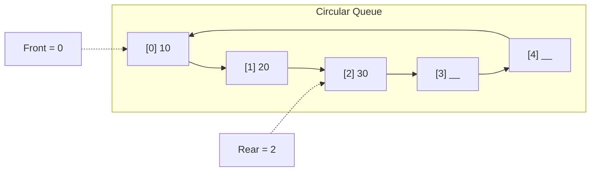

# Answer Templates by Mark Level

Templates for writing examination answers calibrated to specific mark bands. Each template shows the expected structure and includes a filled example.

---

## 1-2 Mark Answer (Direct Definition)

### Template

```
**{{Concept}}** is {{category/type}} that {{core function/purpose}} using {{key mechanism}}.
{{One key formula, property, or fact.}}
```

### Example: Define a Stack (2 Marks)

**Stack** is a linear data structure that follows the Last-In-First-Out (LIFO) principle. The element inserted last is the first one to be removed. Its two main operations are **push** (insert at top) and **pop** (remove from top). Time complexity for both operations is O(1).

---

## 3-5 Mark Answer (Structured Short)

### Template

```
**Introduction:** 1-2 sentence definition with core idea.

**Explanation:** 3-4 sentences covering the main concept, mechanism, or process.

**Example / Key Points:**
- Point 1 with brief explanation
- Point 2 with brief explanation

**Diagram** (if applicable): Simple labeled diagram.
```

### Example: Explain Binary Search Algorithm (5 Marks)

Binary Search is an efficient searching algorithm that works on **sorted arrays**. It repeatedly divides the search space in half by comparing the target value with the middle element.

**How it works:**
The algorithm starts by checking the middle element of the array. If the target matches, the search ends. If the target is smaller than the middle element, the search continues in the left half. If larger, it continues in the right half. This process repeats until the element is found or the search space becomes empty.

**Example:**
Search for 7 in array [2, 4, 6, 7, 9, 11, 15]:
- Step 1: Mid = 7 → Found at index 3

**Time Complexity:** O(log n) — because the search space halves at each step.
**Space Complexity:** O(1) for iterative, O(log n) for recursive implementation.

**Key requirement:** The array must be sorted before applying binary search.

---

## 5-8 Mark Answer (Medium with Diagram)

### Template

```
**Introduction:** 2-3 sentences defining the concept and its significance.

**Diagram:**
[Clear labeled diagram showing structure/process]

**Working / Detailed Explanation:**
Step-by-step explanation (numbered for processes, bulleted for properties).
4-6 key points with actual explanations, not just keywords.

**Example:**
Concrete numerical or code example showing the concept in action.

**Comparison / Summary Table** (if relevant):
| Feature | Value |
|---------|-------|

**Applications:** 2-3 real uses.
```

### Example: Explain Circular Queue with Diagram (7 Marks)

A **Circular Queue** solves the main limitation of a simple queue — wasted space. In a simple queue, once elements are dequeued from the front, those positions cannot be reused even if the queue is not full. A circular queue connects the rear end back to the front, forming a circle.



**How it works:**
1. Both `front` and `rear` start at position 0.
2. When inserting (enqueue), move `rear` forward: `rear = (rear + 1) % SIZE`.
3. When removing (dequeue), move `front` forward: `front = (front + 1) % SIZE`.
4. The queue is **full** when `(rear + 1) % SIZE == front`.
5. The queue is **empty** when `front == rear`.

**Example operations on a circular queue of size 5:**

| Operation | Front | Rear | Queue State |
|-----------|-------|------|-------------|
| Enqueue 10 | 0 | 1 | [10, _, _, _, _] |
| Enqueue 20 | 0 | 2 | [10, 20, _, _, _] |
| Dequeue | 1 | 2 | [_, 20, _, _, _] |
| Enqueue 30 | 1 | 3 | [_, 20, 30, _, _] |

**Applications:** CPU scheduling, memory buffer management, traffic signal control systems.

---

## 10-15 Mark Answer (Comprehensive Essay)

### Template

```
**1. Introduction (2-3 sentences):**
Define the concept. State why it matters. Set context.

**2. Detailed Diagram:**
Full architectural/structural diagram with labels and legend.

**3. Detailed Explanation (core body):**
Cover definition, types, working principle, algorithm, or derivation.
6-10 paragraphs with specific technical content.

**4. Code / Derivation / Algorithm:**
Complete implementation with comments or mathematical proof.

**5. Dry Run / Step-by-Step Trace:**
Table showing the algorithm running on sample data.

**6. Complexity Analysis:**
- Best case: O(?)
- Average case: O(?)
- Worst case: O(?)

**7. Applications:**
3-4 practical real-world uses.

**8. Advantages and Disadvantages:**
2-3 of each.

**9. Conclusion (1-2 sentences):**
Summarize the core takeaway.
```

---

## Numerical Answer Template

### Template

```
**Given:** List all provided values with units.

**Required:** State what needs to be found.

**Formula:** Write the relevant formula with variable names.

**Explanation:** One sentence explaining what the formula means.

**Substitution:** Plug in the given values.

**Calculation:** Show step-by-step arithmetic.

**Answer:** Final result with correct units.

**Verification** (if applicable): Quick check that the answer is reasonable.
```

---

## Comparison Answer Template

### Template

```
**Introduction:** 1 sentence stating what is being compared.

| Feature | {{Concept A}} | {{Concept B}} |
|---------|---------------|---------------|
| Definition | ... | ... |
| Structure | ... | ... |
| Operations | ... | ... |
| Time Complexity | ... | ... |
| Memory Usage | ... | ... |
| Applications | ... | ... |
| Key Advantage | ... | ... |

**Key Takeaway:** 1-2 sentences summarizing the main differences.
```

---

## Diagram-Based Answer Template

### Template

```
**Definition:** 1-2 sentences.

**Diagram:**
[Well-labeled diagram — use Mermaid, ASCII art, or SVG]
Figure X: Caption

**Explanation of Diagram:**
Walk through the diagram components (3-5 sentences explaining what each part does).

**Working Process:** Numbered steps if applicable.
```

---

## Programming Answer Template

### Template

```
**Problem Statement:** Restate the problem in one sentence.

**Approach / Algorithm:**
1. Step 1
2. Step 2
3. Step 3

**Code:**
[Language: C/C++/Java/Python]
// Comments explaining key logic

**Output:**
[Expected output for sample input]

**Explanation:**
Walk through the code logic (3-4 sentences).

**Time Complexity:** O(?)
**Space Complexity:** O(?)

**Common Errors:**
- Error 1: Why it happens and how to avoid it.
```
