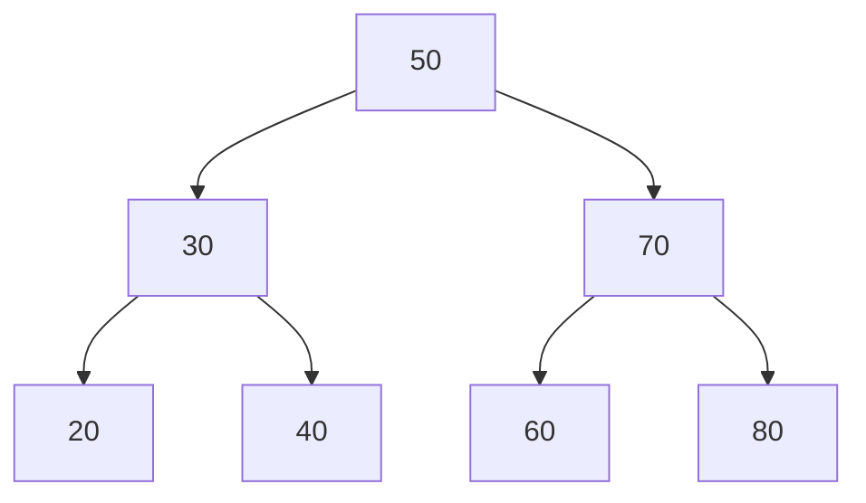

# Study Notes Template

## Unit {{UNIT_NUMBER}}: {{UNIT_TITLE}}

> **Syllabus Reference:** {{SYLLABUS_REF}}
> **Exam Weightage:** {{WEIGHTAGE}} marks | **PYQ Frequency:** {{FREQUENCY}}

---

### Unit Overview

{{Write 2-3 sentences introducing what this unit covers and why it matters. Connect it to the broader subject.}}

---

## Topic {{TOPIC_NUMBER}}: {{TOPIC_NAME}}

> **Importance:** {{critical/high/medium/low}} | **Asked in:** {{LIST_EXAM_YEARS}}

### What Is {{TOPIC_NAME}}?

{{A clear, 2-3 sentence definition. Use simple English. Include the core idea that makes this concept unique.}}

### Real-World Analogy

{{An everyday analogy that makes the concept click. Example: "A stack works like a pile of plates — you always pick from the top."}}

### How It Works

{{Step-by-step explanation of the working principle. Use numbered steps for processes. Keep each step to 1-2 sentences.}}

1. {{Step 1}}
2. {{Step 2}}
3. {{Step 3}}

### Visual Diagram

```mermaid
{{Mermaid diagram showing the concept — flowchart, block diagram, or state diagram.}}
```

**Figure {{FIG_NUMBER}}:** {{Diagram caption explaining what it shows.}}

### Types / Classification

| Type | Key Feature | Use Case |
|------|-------------|----------|
| {{Type 1}} | {{Feature}} | {{When to use}} |
| {{Type 2}} | {{Feature}} | {{When to use}} |

### Key Characteristics

- {{Characteristic 1 — explain in one sentence}}
- {{Characteristic 2 — explain in one sentence}}
- {{Characteristic 3 — explain in one sentence}}

### Advantages

1. {{Advantage with brief explanation}}
2. {{Advantage with brief explanation}}

### Disadvantages

1. {{Disadvantage with brief explanation}}
2. {{Disadvantage with brief explanation}}

### Applications

- {{Application 1 — where this concept is used in practice}}
- {{Application 2 — real software/system that uses this}}

### Code Example

```c
{{Short, clean code example with comments explaining key lines.}}
```

**Output:**
```
{{Expected output of the code}}
```

### Common Mistakes

| Mistake | Why It's Wrong | Correct Approach |
|---------|---------------|------------------|
| {{Mistake 1}} | {{Explanation}} | {{What to do instead}} |

---

### Key Terms

| Term | Meaning |
|------|---------|
| {{Term 1}} | {{Simple definition}} |
| {{Term 2}} | {{Simple definition}} |

---

## Quick Revision: Unit {{UNIT_NUMBER}}

### Must-Remember Points

1. {{Core fact #1}}
2. {{Core fact #2}}
3. {{Core fact #3}}
4. {{Core fact #4}}
5. {{Core fact #5}}

### Important Formulas

- {{Formula 1}}: `{{expression}}`
- {{Formula 2}}: `{{expression}}`

### Key Differences

| Feature | {{Concept A}} | {{Concept B}} |
|---------|---------------|---------------|
| {{Feature 1}} | {{Value}} | {{Value}} |
| {{Feature 2}} | {{Value}} | {{Value}} |

### Related Exam Questions

| Q# | Question | Marks | Year |
|----|----------|-------|------|
| 1 | {{Question text}} | {{marks}} | {{year}} |
| 2 | {{Question text}} | {{marks}} | {{year}} |

---

## Filled Example: Binary Search Tree

### What Is a Binary Search Tree?

A Binary Search Tree (BST) is a tree data structure where each node has at most two children, and the left child always holds a value smaller than its parent while the right child holds a larger value. This arrangement makes searching, inserting, and deleting elements efficient because you can eliminate half the remaining nodes at each step.

### Real-World Analogy

Think of searching a word in a dictionary. You open the middle page — if your word comes before the current page alphabetically, you look in the left half. If it comes after, you look in the right half. A BST works exactly this way with data.

### How It Works

1. Start at the root node.
2. Compare the target value with the current node.
3. If the target is smaller, move to the left child.
4. If the target is larger, move to the right child.
5. Repeat until you find the value or reach a null pointer.

### Visual Diagram



**Figure 1:** A BST with root 50. Left subtree contains values less than 50; right subtree contains values greater than 50.

### Key Characteristics

- Every left descendant is smaller than its ancestor
- Every right descendant is larger than its ancestor
- In-order traversal gives sorted output
- Average search time is O(log n), worst case O(n) for skewed trees
